# 🏃 Спортен дневник

Android приложение за записване, проследяване и анализ на спортни тренировки.

## 👨‍🎓 Автор

- **Име и фамилия:** Димитър Стоичев
- **Факултетен номер:** 2401321073
- **Специалност:** Софтуерно инженерство
- **Курс:** 3
- **Форма на обучение:** редовно

## 📱 1. Идея и описание на проекта

„Спортен дневник“ е Android приложение, разработено с Java и XML интерфейси. То позволява на потребителите да записват своите тренировки, да следят спортните си резултати и да анализират физическата си активност.

Основната идея е да се предостави удобно място за съхраняване на информация за тренировките и проследяване на личния спортен напредък.

## ✨ 2. Основни функционалности

- Добавяне, редактиране и изтриване на тренировки.
- Записване на спорт, дата, продължителност, калории и бележки.
- Търсене на тренировки по спорт, дата и бележки.
- Филтриране по вид спорт.
- Общ преглед на тренировките и статистиката.
- Графично представяне на спортната активност.
- Календар с тренировките.
- Седмични спортни цели.
- Система за постижения и значки.
- Проследяване на тренировъчни серии (Streak).
- Известия при подобряване на лични рекорди.
- Напомняния за тренировки.
- Месечни отчети със сравнение на резултатите.
- Експортиране на тренировките в CSV формат.
- Профил и персонални настройки.
- Светла и тъмна тема.
- Персонализирани поздрави и мотивационни съобщения.
- Споделяне на информация за тренировки.

## ⚙️ 3. Как работи приложението

При стартиране потребителят попада на началния екран, където може да прегледа своите тренировки и да получи достъп до останалите функционалности.

### Управление на тренировките

Потребителят може да добавя нова тренировка, като въвежда вид спорт, дата, продължителност, изгорени калории и допълнителна бележка. Записите се съхраняват локално в Room Database.

Съществуващите тренировки могат да бъдат преглеждани, редактирани и изтривани. Предоставени са търсене и филтриране по вид спорт, за да се намират по-лесно конкретни записи.

### Статистика и анализ

Приложението обобщава спортната активност и представя информация за тренировките. Чрез графики потребителят може да проследи активността си за последните седем дни.

Налични са календарен изглед и месечни отчети, които позволяват сравнение между текущия и предходния месец.

### Цели и постижения

Потребителят може да задава седмични спортни цели и да следи изпълнението им. Системата за постижения предоставя значки според броя тренировки, времето за активност и изгорените калории.

Приложението проследява последователните дни с тренировки (Streak) и показва известия при подобряване на лични рекорди.

### Напомняния и известия

Потребителят може да настройва напомняния за тренировки. За тяхното планиране се използва Android AlarmManager, а известията се показват чрез системата за Android Notifications.

### Експорт и персонализация

Данните за тренировките могат да бъдат експортирани в CSV формат и споделяни чрез други приложения.

В профила потребителят може да задава име, предпочитан спорт и тема на приложението. Поддържат се светъл и тъмен режим, както и персонализирани поздрави и мотивационни съобщения.

## 🛠️ 4. Използвани технологии

- Java 11
- Android SDK
- XML Layouts
- Android Studio
- Room Database
- SQLite
- Android Jetpack ViewModel
- LiveData
- Repository Pattern
- Dependency Injection чрез AppContainer
- Material Design 3
- MPAndroidChart
- SharedPreferences
- AlarmManager
- Android Notifications
- FileProvider

## 🏗️ 5. Архитектура

Приложението използва MVVM архитектура (Model–View–ViewModel), комбинирана с Repository Pattern.

Основните компоненти са:

- **Model:** класовете за данни и Room базата данни.
- **View:** XML интерфейсите и Activity класовете, които представят информацията на потребителя.
- **ViewModel:** управлява данните и комуникацията между интерфейса и Repository.
- **Repository:** обработва операциите с базата данни и осигурява достъп до данните.
- **AppContainer:** осигурява зависимостите на приложението.

Това разделение улеснява поддръжката, тестването и разширяването на проекта.

## 🗄️ 6. База данни

Използва се Room Database върху SQLite. Данните за тренировките се съхраняват локално на устройството.

Таблицата `workouts` съдържа следните полета:

| Поле | Описание |
|---|---|
| id | Уникален идентификатор |
| sport | Вид спорт |
| date | Дата на тренировката |
| duration | Продължителност в минути |
| calories | Изгорени калории |
| note | Допълнителна бележка |

Поддържат се пълни CRUD операции:

- **Create** – добавяне на тренировка.
- **Read** – извличане и преглед на тренировки.
- **Update** – редактиране на тренировка.
- **Delete** – изтриване на тренировка.

Допълнителни настройки, като седмични цели и потребителски предпочитания, се съхраняват чрез SharedPreferences.

## 🔄 7. Потребителски поток

1. Потребителят стартира приложението.
2. От началния екран преглежда записаните тренировки и статистиката.
3. Добавя нова тренировка или избира съществуваща за редактиране или изтриване.
4. Използва търсенето и филтрите, за да открива конкретни тренировки.
5. Отваря статистиката и графиките, за да проследи своя напредък.
6. Преглежда календара, седмичните цели и постигнатите значки.
7. Настройва напомняния и преглежда известията.
8. При необходимост експортира или споделя информация за тренировките.
9. Персонализира профила и външния вид на приложението.

## 🧪 8. Тестване

Проектът включва общо **52 успешни теста**, разпределени по следния начин:

- **10 Model Unit теста** – проверяват създаването и стойностите на обектите Workout.
- **17 ViewModel Unit теста** – проверяват логиката на ViewModel и обработката на данните.
- **21 Repository Unit теста** – проверяват операциите и взаимодействието с базата данни.
- **3 Instrumented теста** – проверяват контекста, стартирането на MainActivity и основните елементи на началния екран.
- **1 Espresso тест** – проверява сценарий за добавяне на тренировка през потребителския интерфейс.

Всички изброени тестове са преминали успешно.

## ▶️ 9. Стартиране на проекта

1. Инсталирайте Android Studio.
2. Клонирайте GitHub хранилището или изтеглете проекта.
3. Отворете проекта чрез Android Studio.
4. Изчакайте Gradle Sync да приключи.
5. Стартирайте приложението на Android емулатор или физическо устройство.
6. Използвайте началния екран за достъп до основните функционалности.

## 👤 10. Тестови акаунти

Приложението не използва система за регистрация и вход с потребителско име и парола.

Не са необходими тестови акаунти. След стартиране потребителят може директно да използва функционалностите на приложението.

## 📸 11. Екранни снимки

В тази секция се добавят реални екранни снимки от работещото приложение.

Препоръчителни снимки:

- Начален екран – `screenshots/home.png` `screenshots/home_1.png`
- Добавяне на тренировка – `screenshots/add-workout.png`
- Редактиране на тренировка – `screenshots/edit-workout.png`
- Статистика и графика – `screenshots/statistics.png` `screenshots/statistics_1.png` 
- Календар – `screenshots/calendar.png`
- Цели и постижения – `screenshots/goals.png` `screenshots/achievements.png`
- Напомняния за тренировки - `screenshots/notifications.png`
- Потребителски профил – `screenshots/profile.png`
- Експортиране на тренировка – `screenshots/exportToCsv.png`

След добавяне на изображенията в папката `screenshots` те могат да бъдат показани в README чрез Markdown:

```markdown
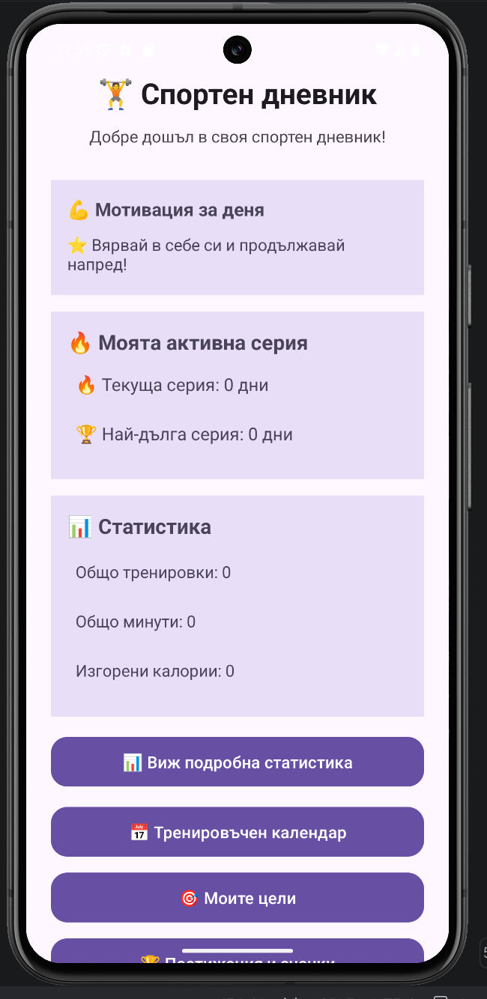

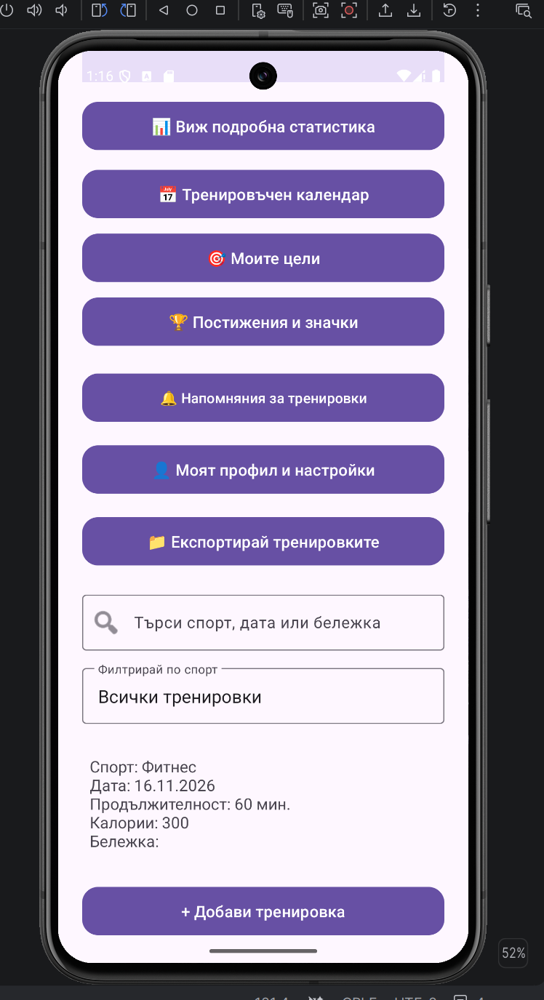

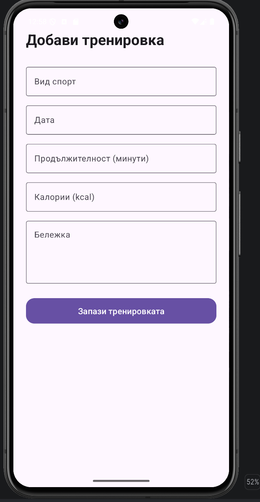

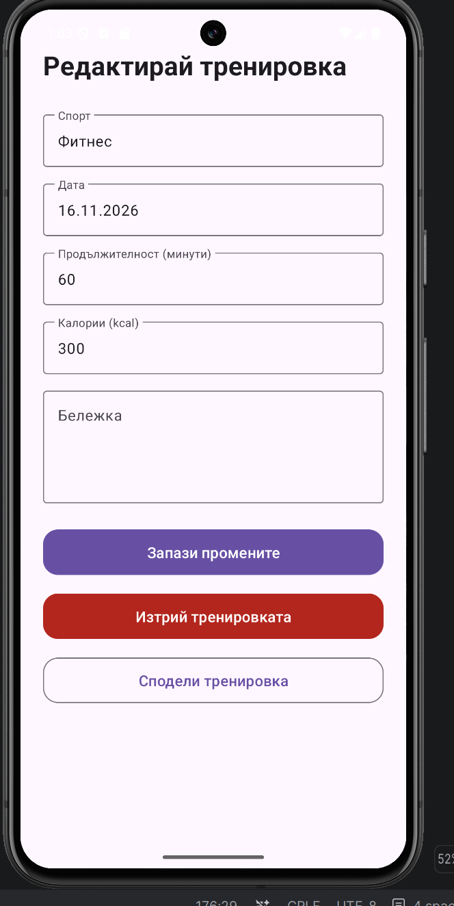

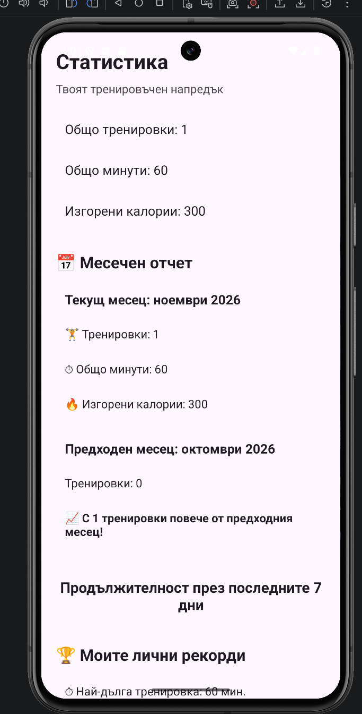

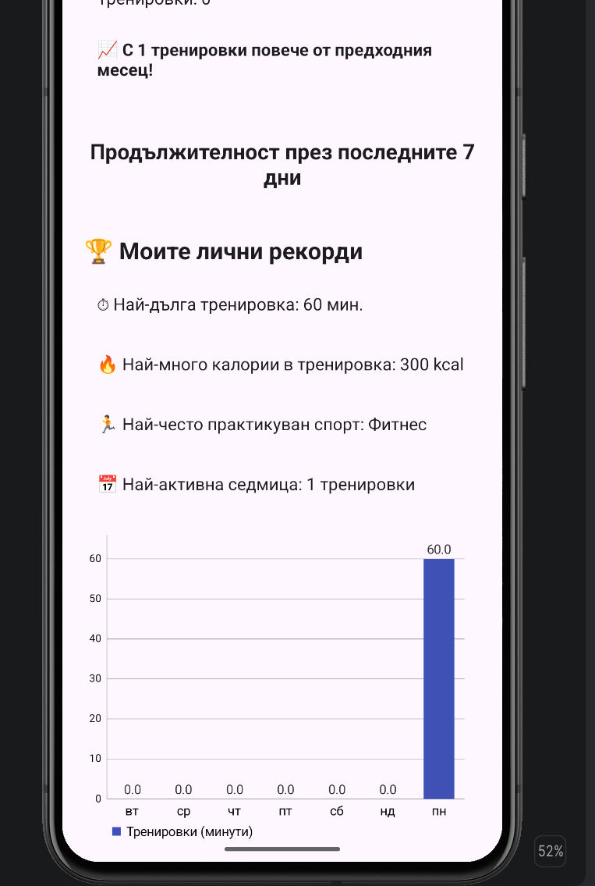

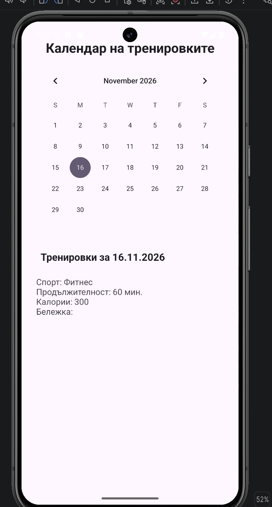

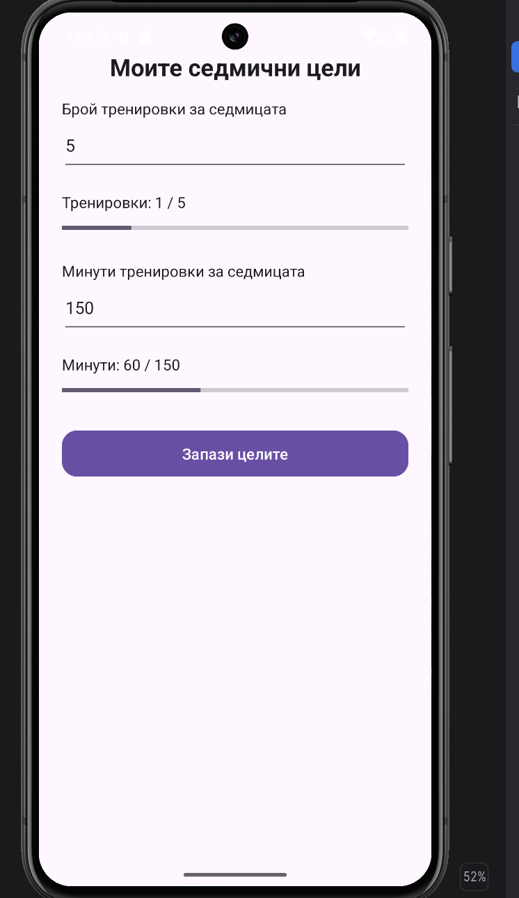

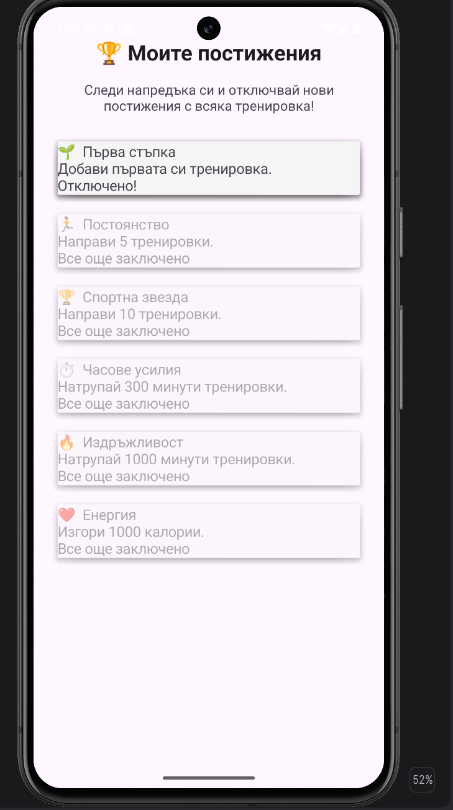

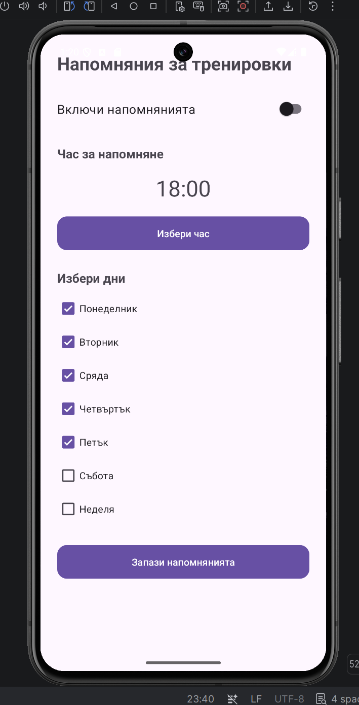

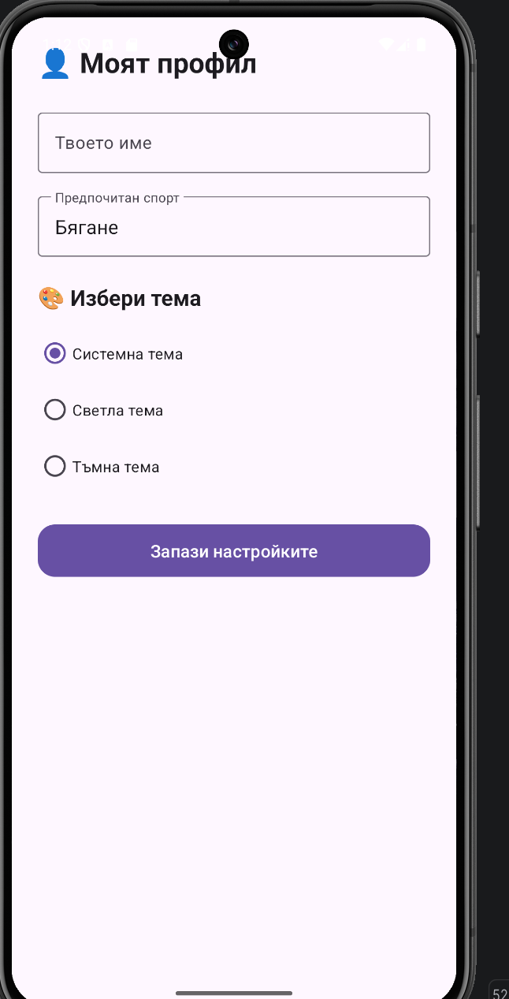

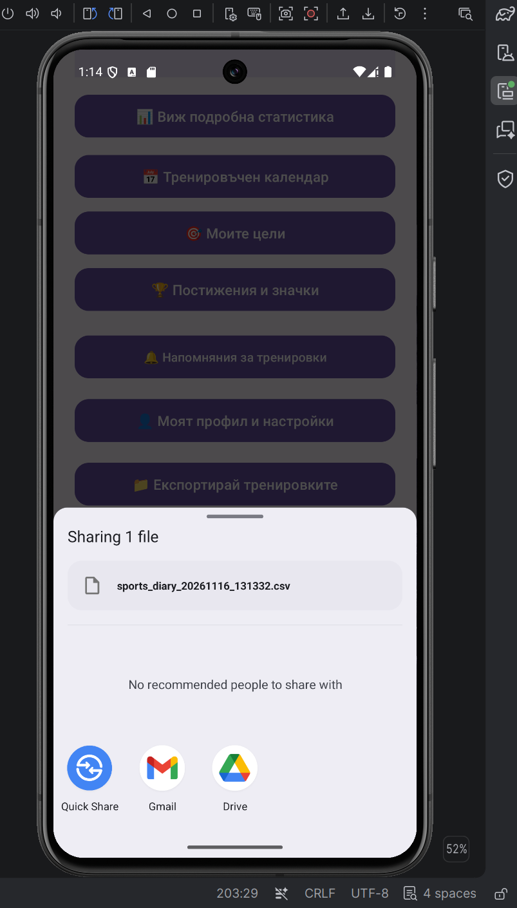
```

## 📦 12. APK файл

Приложението може да бъде генерирано като APK файл от Android Studio:

1. Отворете менюто **Build**.
2. Изберете **Build Bundle(s) / APK(s)**.
3. Натиснете **Build APK(s)**.
4. След успешното генериране APK файлът се намира в:

`app/build/outputs/apk/debug/app-debug.apk`

За предаване чрез GitHub може да се създаде Release и към него да се прикачи генерираният APK файл.

**Линк към APK:** Добавете тук реалния линк към GitHub Release или към качения APK файл.

## 📚 13. Предназначение

Проектът е разработен с учебна цел и демонстрира използването на Java, Android SDK, Room Database, MVVM архитектура, автоматизирано тестване и съвременни Android интерфейси.